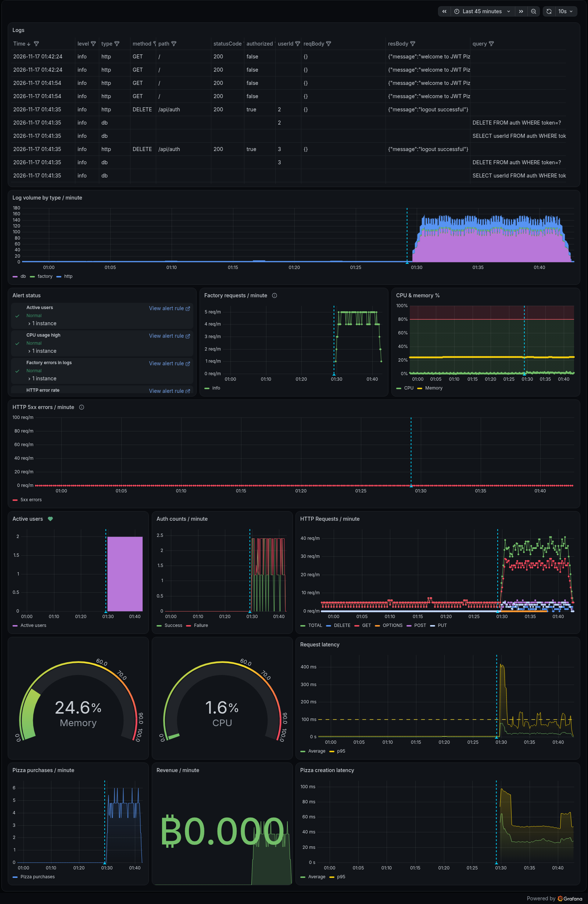
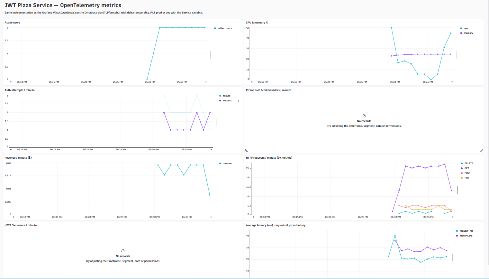

# Curiosity Report: OpenTelemetry and Backend Switching with Grafana and Dynatrace

## Introduction
OpenTelemetry is an open standard for gathering and exporting telemetry data. I thought this would be an interesting topic for my curiosity project because at my work, we have been in the middle of migrating from an older observability platform to Dynatrace. Since we have been using Grafana in this class, I thought it would be interesting to learn more about OpenTelemetry, how it connects to observability platforms like Grafana and Dynatrace, and experiment with swapping out observability backends using OpenTelemetry.

---

## What is Observability?
Observability is what transforms an application from a "black box" to a "glass box", meaning that you have a way of observing the behavior of your application and why it is behaving the way that it does. Observability consists of three primary categories of features: metrics, logs, and traces. Metrics are numerical measurements that are collected and aggregated from your application. Logs provide records of particular events that happen in an application and what time they occur. Logs can give additional insight into why the application is behaving a certain way, such as what might be causing bad metrics. Traces provide insight into where issues happen in an application, such as what system can be identified as the originator of a slowdown. 

### The Observability Lifecycle
To implement an observability system, you first need to instrument your code so that it emits observability characteristics—namely traces, metrics, and/or logs. After these data have been collected, they must be stored (usually by an observability backend) and frequently displayed so that they can actually be used to analyze an application. 

### USB-C and OpenTelemetry
In 2014, USB-C was introduced to the market as a solution to the fragmented landscape of specialized cables that only worked with specific types of hardware. One of the primary selling points of USB-C cables was that it could work as a universal cable for several types of hardware. Instead of requiring a new cable every time you acquired a new piece of hardware, you could simply reuse a USB-C cable you already had. 

OpenTelemetry is like the USB-C cable of observability. It provides a standard for collecting (electricity) and transporting (wire) to an observability service (hardware) in a standardized way. It does not itself store or display observability data, but it solves the standardization problem of observability generation, collection and transportation, reducing vendor lock-in and allowing solutions to use the platform that best meets their needs rather than the one that requires the least effort to adopt. 

The vast majority of observability platforms now support OpenTelemetry, and it is considered the industry standard for generating and collecting observability information. 

---

## Experiment: One OpenTelemetry Instrumentation, Two Backends

My goal with this experiment was to observe the benefits of OpenTelemetry by first replacing my hand-built metrics code in my `jwt-pizza-service/src/metrics.js` with the official OpenTelemetry SDK, then sending the *same* instrumentation to both Grafana Cloud and Dynatrace and compare.

### Environment

| Item | Version |
|------|---------|
| OS | Windows 11 (10.0.26200) |
| Node.js | 22.13.0 (CI: Node 22.x on GitHub Actions) |
| jwt-pizza-service starting point | tag `pre-otel` (commit `10a6ffc`) |
| jwt-pizza-service ending point | commit `c8f41d1` |
| `@opentelemetry/api` | 1.10.0 |
| `@opentelemetry/sdk-metrics` | 3.1.1 |
| `@opentelemetry/resources` | 3.1.1 |
| `@opentelemetry/semantic-conventions` | 1.45.0 |
| `@opentelemetry/exporter-metrics-otlp-http` (Grafana, JSON) | 0.301.2 |
| `@opentelemetry/exporter-metrics-otlp-proto` (Dynatrace, protobuf) | 0.301.2 |
| Grafana | Grafana Cloud (OTLP gateway → Prometheus/Mimir) |
| Dynatrace | SaaS free trial, platform token with `openpipeline:metrics:ingest` |
| dtctl (Dynatrace CLI, for the dashboard) | 0.45.0 |

### Setup

**Starting point.** I began this project after completing deliverable 11, so my metrics had already been long completed, but I had originally written my metrics manually rather than conforming to the OpenTelemetry standard. My starting point is tagged in my `jwt-pizza-service` repo as `pre-otel`, and concludes with commit `c8f41d1`. The code I changed can therefore be observed directly by viewing those changes. In this report, I will focus primarily on the high-level steps that I took for this experiment. 

**1. Switching to the OpenTelemetry SDK.** I installed the OpenTelemetry packages listed above and rewrote `metrics.js` around the OpenTelemetry capabilities. I did this in two commits:
- `422db69`: same metric names as before, just produced by the SDK
- `4c16d12`: renamed everything to follow OpenTelemetry's semantic conventions: an `http.server.request.duration` histogram (in seconds) in place of four hand-rolled request/error/latency counters, `pizza.*` names for the business metrics, `system.cpu.utilization` / `system.memory.utilization`, and `service.name` / `service.version` / `service.instance.id` as resource attributes instead of a `source` label on every data point

**2. Updating Grafana.** I didn't change any Grafana configuration since the SDK sends to the same OTLP endpoint with the same credentials. But Grafana converts OTLP names into Prometheus names, so I had to rewrite every dashboard query to match.

**3. Setting up Dynatrace.** Dynatrace is a paid observability platform, but they do offer a 15-day free trial, which I utilized for the purposes of this project. To get it working with my pipeline, I created a platform token and created two new secrets in my GitHub repo for this token and the OTLP metrics endpoint. I also added these to my local `config.js` file.

**4. Exporting to both backends.** I added a second reader to the same `MeterProvider` so that every measurement would be sent to both Grafana and Dynatrace. Notably, Dynatrace only accepts binary protobuf (not JSON) and only delta temporality, so its exporter is configured differently from Grafana's:

```js
const readers = [new PeriodicExportingMetricReader({ exporter: grafanaExporter, exportIntervalMillis: period })];

if (config.dynatrace?.endpointUrl) {
  const dynatraceExporter = new OTLPProtoMetricExporter({          // protobuf instead of JSON
    url: config.dynatrace.endpointUrl,
    headers: { Authorization: `Bearer ${config.dynatrace.apiToken}` },
    temporalityPreference: AggregationTemporalityPreference.DELTA, // delta instead of cumulative
  });
  readers.push(new PeriodicExportingMetricReader({ exporter: dynatraceExporter, exportIntervalMillis: period }));
}
```
It's worth pointing out that although Dynatrace requires a different format for its data than Grafana does, the actual code required to configure Dynatrace to receive metrics was very minimal (essentially just this code!). By comparison, if I had not been using OpenTelemetry, I would have had to rewrite how all of my metrics were gathered. OpenTelemetry's solution is definitely more slick. 

**5. Generating data and comparing.** I deployed the change (`c8f41d1`), ran my `simulateTraffic.sh` script against production for several minutes, and built a matching Dynatrace dashboard using DQL. To compare the backends, I queried both for the same 10-minute window. The results are captured below. 

### Results

Below is a table representing the metrics tracked by both Grafana and Dynatrace over a ten-minute period of simulated traffic on the jwt-pizza service. Also included are images of the respective dashboards and the data they display. 

**Same 10 minutes of production traffic (01:31–01:41 UTC), read from both backends:**

| Metric | Grafana (PromQL `increase`) | Dynatrace (DQL `sum`) |
|---|---|---|
| HTTP requests | 352.9 | 355 |
| 5xx errors | 0 | 0 |
| Auth successes | 13.2 | 14 |
| Auth failures | 21.4 | 22 |
| Orders | 46.8 | 47 |
| Pizzas sold | 46.8 | 47 |
| Revenue (₿) | 0.1778 | 0.1786 |
| Avg request latency | 20.32 ms | 20.55 ms |
| Avg factory latency | 28.50 ms | 28.49 ms |

> **Note:** The numbers are nearly identical, but differ slightly due to differing collection methods. Grafana estimates intervals while Dynatrace stores increments per interval and adds them up. Both are also slightly fuzzy at the window edges. These differences together account for the minor discrepancies.

**Grafana dashboard** (same OpenTelemetry metrics, cumulative temporality, queried with PromQL; the dashed blue line is the deploy):



**Dynatrace dashboard** (same OpenTelemetry metrics, delta temporality, queried with DQL):



---

## What I Learned

While I didn't implement all of the same observability features from Grafana in Dynatrace (most notably logging), the images above show an observability system that works pretty well for both the Dynatrace setup and Grafana setup. What it doesn't show is that there were a few hiccups along the way. Most notably, there are different ways of gathering some of the metrics. I have been using the cumulative method for Grafana, which tracks running totals and estimates metrics over a window of time, while Dynatrace chunks windows and adds them up and does not support the cumulative method. My first attempt at getting the system set up resulted in most of the metrics failing to load in Dynatrace. 

Although my experiment did involve a lot of code and query configuration changes up front, that was primarily because I did not initially conform to OpenTelemetry's standards. After I made the switch, switching platforms or using multiple platforms became easy. Without OpenTelemetry, I would have had to rewrite a lot of code to reimplement my metric collection or duplicate it if I wanted to send data to both Grafana and Dynatrace. However, because OpenTelemetry handled all of the collection for me, all I had to implement was a very simple configuration change so that Dynatrace would be sent metrics in the format it accepted. I think the biggest takeaway from the experience is that OpenTelemetry effectively acts as an adapter; yes, different services may require different data formats, but OpenTelemetry adapts based on the service and makes it very easy to switch between services without hassle. 

---

## How I Researched OpenTelemetry

There are a few different components of this topic, but the primary thing I wanted to learn about was OpenTelemetry itself. Experimenting with it using Dynatrace was an application of what I learned about OpenTelemetry rather than the primary goal of my curiosity project. Therefore, once I decided on my topic, most of my research involved reading through OpenTelemetry's website, along with a few articles on general observability principles. 

Although perhaps an experiment in its own right, I also ran the demo on OpenTelemetry's website, where they have a mock online shop and several platforms where you can observe the collected telemetry data from the marketplace. This helped give me a good understanding of what OpenTelemetry was and why you would want to use it before conducting my own experiment. 

---

## References

- [What is Observability?](https://www.dynatrace.com/news/blog/what-is-observability-2/) (Dynatrace blog): metrics, logs, and traces, and why observability matters
- [What is OpenTelemetry?](https://opentelemetry.io/docs/what-is-opentelemetry/) (OpenTelemetry docs): what OTel is, and what it deliberately leaves to backends
- [OpenTelemetry Components](https://opentelemetry.io/docs/concepts/components/) (OpenTelemetry docs): specification, OTLP, semantic conventions, SDKs, and the Collector
- [OpenTelemetry Demo](https://opentelemetry.io/docs/demo/) (OpenTelemetry docs): the sample shop I ran to see one set of telemetry shown in several tools
- [Ingest OTLP metrics](https://docs.dynatrace.com/docs/ingest-from/opentelemetry/otlp-api/ingest-otlp-metrics) (Dynatrace docs): supported metric types and the delta-only temporality limitation
